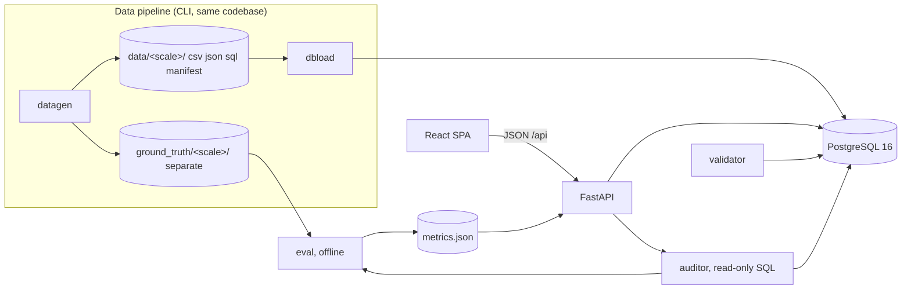
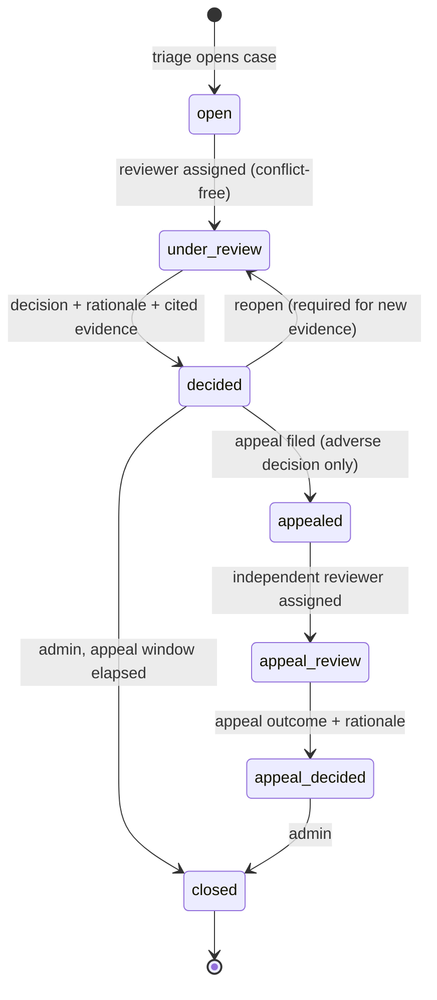

# High-level design

Status: proposal, reviewed ([04-review.md](04-review.md)). Designed from [requirements.md](../requirements.md). Earlier architecture
notes and decisions are drafts and are superseded where this differs. Tier detail: [DB](01-database-plan.md),
[backend](02-backend-plan.md), [frontend](03-frontend-plan.md).

## 1. Goal and scope
One system, two graded jobs:
1. **Dataset**: reproducible synthetic data (10,000 submissions, 1,000 flags, 300 cases, seed 20261022) with four labelled
   anomalies, separate ground truth, data dictionary, manifest and validation summary (A6, F, G, H, I, J, K).
2. **Workflow app**: staff handle cases, evidence, conflict-free assignment, decisions, appeals and closure with a complete
   audit trail, and the system **proves** the due-process rules hold (A1-A5, E, H3).

Principle: a flag triggers **human review, never automatic guilt** (E3, G1). Deterministic code decides; AI only explains.
Asymmetry: the system may auto-**dismiss** a flag by a documented rule (in the learner's favour); it can never auto-**confirm**.
Non-goals: real plagiarism detection, authentication, production polish, real learner data.

## 2. System context

Only `datagen` (writes) and `eval` (reads) touch ground truth. App, validator and auditor never do (I2); a test enforces it.
The API runs the auditor live (it reads only the DB) and serves `metrics.json` as a static file stamped with the dataset hash.

## 3. Components
| Component | Responsibility |
|---|---|
| Frontend | Queue, case workspace, rules page, audit page. No business rules; legality comes from the server. |
| API | HTTP, Pydantic validation, error envelope, actor lookup. No SQL, no rules. |
| Services | One function per use case, one transaction; pure rules; row and event written together. |
| Rules (pure) | Score band, triage, conflict of interest, appeal independence, transition table, guards. No IO, no clock. |
| Queries | All SQL, plain psycopg. |
| Datagen | Seeded, scenario-driven; valid baseline first, then labelled anomalies and decoys; writes ground truth. |
| Validator | **Data-quality** checks (keys, joins, enums, dates, reconciliation, legal transitions, duplicates). Must pass 100%, anomalies included. |
| Auditor | **Due-process** checks written from the brief, not importing `rules`. Should find exactly the labelled anomalies. |
| Eval | Scores auditor and triage against ground truth. Offline. |
| AI brief (optional, last) | Advisory case summary; off by default; cached replay; deterministic template fallback. |
Dependencies: `api -> services -> queries -> db`, `services -> rules`. CLI tools share `ids`, `models`, schema; not the HTTP layer.

## 4. Domain model (summary)
Ten brief entities plus bridges `case_reviewer` (case N:M reviewer) and `decision_evidence` (decision N:M evidence) and the
append-only `case_event` log. **A flag is not a table**: it is a similarity report whose raw score reaches the review threshold of the
rule in force (Q1), exposed as view `v_flag`. Its outcome (case opened or auto-dismissed with a reason) is derived. Detail: [DB plan](01-database-plan.md).

### Score, flag and triage (one documented rule, fractions 0-1, Q7)
`adjusted = raw - quoted - template`. Band of a score: <0.30 no_action, 0.30-0.599 log_only, 0.60-0.799 review, >=0.80 priority_review.
- **Flag**: `raw >= review_threshold` (1,000 of 10,000).
- **Case**: flag whose `band(adjusted)` is review or priority_review (300). Otherwise auto-dismissed: reason `quote_only` or
  `template_match`, whichever exclusion is larger (700).
- False positives = dismissed flags plus cases a human decides `no_violation`.

### Lifecycle (one transition table in code)

### The four negative scenarios (single definition used by datagen, API tests and auditor)
| | Injected anomaly (structurally valid) | App behaviour | Decoy (legitimate near-miss) |
|---|---|---|---|
| G1 | `violation_confirmed` decision with no human reviewer (`reviewer_id` NULL), events by system actor | no code path from score to decision; decision needs an assigned human | quick human decision citing one evidence item |
| G2 | assignment of a conflicted reviewer | 409 `CONFLICT_OF_INTEREST` | reviewer who reviewed a different learner on the same assessment |
| G3 | evidence added after the latest decision, no reopen event, no `evidence_added` event | 409 `REOPEN_REQUIRED`; evidence immutable | evidence after decision preceded by a reopen event |
| G4 | case closed after an appeal decided by a non-independent reviewer | 409 `NOT_INDEPENDENT` / `APPEAL_UNRESOLVED` | appeal decided by an independent reviewer |

## 5. Key decisions
| # | Decision | Why |
|---|---|---|
| H1 | Flag = derived view over `similarity_report`; each report stores the rule version in force at submission time. | Traceable to rule version without a duplicate table (H1 of brief: derive, don't store). |
| H2 | Case status stored plus `version`; every change inserts a `case_event` in the same transaction; validator replays events against the column. | Simple queue queries, optimistic locking, full history (B6). |
| H3 | DB guarantees structure and immutability; business rules live in services and auditor. | Anomalies must load to be detected. |
| H4 | Rules written twice: services and an independent auditor; decoys make precision meaningful. | An auditor graded against its own logic proves nothing. |
| H5 | Scenario-driven generator with exact quotas; outcomes from documented rules plus documented noise. | E8; metrics are not trivially perfect. |
| H6 | No auth; actor = `X-Actor-Id` of a staff row, checked for existence and role (401/403). UI actor picker. | Honest scope; role rules still enforced server-side. |
| H7 | `expected_version` on every case write (409 stale) plus `SELECT ... FOR UPDATE`. No idempotency table. | Two reviewers cannot both decide. |
| H8 | Injected `Clock`; UTC; generated timestamps all before 2026-10-22, so live actions never precede seed data. | Byte-identical reruns (J1); valid date order after demo actions. |
| H9 | Validator (data quality, must pass) and auditor (due process, finds anomalies) are separate tools. | Anomalies are rule violations, not corrupt data (brief: label, don't corrupt). |

## 6. Cross-cutting practices
- **Errors**: one envelope `{error:{code,message,details?}}` plus `x-request-id`; 401/403/404/409/422/500.
- **Transactions**: one per use case; event inserted with the change.
- **Config**: env vars with `.env.example`; no secrets in git; CORS allow-list for the dev origin.
- **Observability**: one structured log line per request (request id, actor, case id, status, ms); `/health` pings DB.
- **Security**: parameterised SQL; app DB role cannot UPDATE/DELETE history; input length caps; actor header is spoofable (stated).
- **Performance**: 10,000 rows is small; indexes only behind real queries; queue under 200 ms at full scale.
- **Privacy and retention**: synthetic names only; production would need auth, access control and a retention policy (stated, not built).
- **Accessibility**: labelled inputs, keyboard actions, status never by colour alone.

## 7. Data and reproducibility
One RNG per purpose: `random.Random(f"{seed}:{purpose}")`. Scores are integers in thousandths, so arithmetic is exact.
Exports are hash-stable: rows sorted by key, fixed column order, LF line endings, UTF-8 without BOM, fixed decimal format,
ISO-8601 `Z` timestamps, JSON with sorted keys, no wall-clock values in the manifest. `cli repro` generates twice into temp dirs
and compares counts and SHA-256 (J1). Starter (1,000/100/30, same code) committed; full manifest committed.

## 8. Quality and evaluation
Few tests at checkpoints: rule boundaries, one service test per negative scenario, auditor detects injections, reproducibility,
schema load, ground-truth isolation, a handful of UI tests. Evaluation (A4, L1):
- **Auditor P/R/F1 per anomaly** (expected near 1.0 by construction; decoys test precision).
- **Triage vs latent truth**: genuine copies caught or missed by the threshold rule, with documented noise (the meaningful number).
- **Decision agreement** vs expected decisions; **validation summary** with distributions (L1a) and boundary coverage (L1e).
Caveat stated everywhere: synthetic scores prove rule coverage, not generalisation.

## 9. Optional AI layer (applied AI)
Last, off by default, read-only: a "case brief" summarising structured case facts for the reviewer. Every ID and number in the
output is checked against the case data; failures fall back to a template. Live calls are cached; the demo runs in replay mode.
Never stored, never an input to rules, decisions or eval. Reported: faithfulness pass rate and fallback rate on 20 cases.

## 10. Build order
| Step | Output | Requirements |
|---|---|---|
| 1 | Schema, ids, models, rules (unit-tested) | B, C, D, E3-E7 |
| 2 | Datagen starter, dbload, validator, data dictionary | F, G, H, I, J, K |
| 3 | Vertical slice: queue -> case -> assign -> decide (API + UI) | A1, E4, E5 |
| 4 | Reopen/evidence, appeal, closure; G1-G4 as tests | E6, E7, G |
| 5 | Auditor + eval; full scale; repro proof | A4, L1, J1 |
| 6 | Rules and audit pages; README, DEMO.md, rehearsal | A2, A7 |
| 7 | Optional AI brief | applied AI |
Feature freeze at about 85% of the time budget.

## 11. Top risks
| Risk | Mitigation |
|---|---|
| Exact counts vs randomness | Quota assignment; anomalies mutate existing rows, never add; validator fails if counts are off |
| Auditor and service share a bug | Independent code, decoys, boundary tests |
| Demo fails live | `dbload --scale full` reset, pinned demo case ids in DEMO.md, AI in replay mode, rehearse |
| Windows line endings change checksums | Write with `newline=""` and LF; `.gitattributes` for `data/` (proposed in review) |
| Brief ambiguity | Ambiguity log; defaults in README |

## Supersedes
`docs/architecture.md`, decisions 0001-0009 (0003, 0004, 0008 stay compatible), `database/schema.sql`, `backend/src/integrity`
tree, frontend content. Exact supersession list in [04-review.md](04-review.md).
