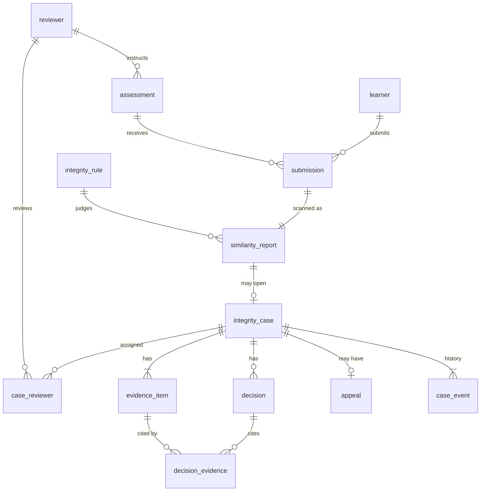

# Database plan (PostgreSQL 16)

Fresh design from [requirements.md](../requirements.md) and the [HLD](00-hld.md). The draft `database/schema.sql` is not a base.

## 1. Principles

1. Structure and immutability in the DB; business rules in services and the auditor (H3), so anomalies stay loadable.
2. Text primary keys in the brief's formats (D1-D5); child IDs embed their parent where the brief says so.
3. Never overwrite history (B6): `case_event`, `evidence_item`, `decision`, `decision_evidence`, `case_reviewer` are insert-only.
4. Timestamps `timestamptz` UTC. Scores are fractions 0-1 as `numeric(4,3)`. Derived values are computed (generated column or view).
5. Plain SQL in one file `database/schema.sql`; drop and recreate (no migration tool; stated in README).

## 2. Entities and relationships

Cardinalities: Learner 1:N Submission; Submission 1:1 SimilarityReport (no rescans; suffix stays `-01`); report 1:0..1 case
(UNIQUE); case N:M reviewer via `case_reviewer`; decision N:M evidence via `decision_evidence`; case 1:0..1 appeal (Q4).
Optional: `decision.reviewer_id` (see G1), appeal reviewer and outcome, `closed_at`. Effective dates on `integrity_rule`.

## 3. Tables

| Table                 | Key and ID format             | Notable columns and constraints                                                                                                                                                                                                                    |
| --------------------- | ----------------------------- | -------------------------------------------------------------------------------------------------------------------------------------------------------------------------------------------------------------------------------------------------- |
| `reviewer`          | REV-000001                    | all staff actors: name, `role` in (instructor, academic_reviewer, academic_administrator, support_staff), `department`                                                                                                                         |
| `learner`           | LRN-000001                    | name, `department`, cohort_year                                                                                                                                                                                                                  |
| `assessment`        | ASM-000001                    | title, `kind`, `department`, `instructor_id` -> reviewer, due_at                                                                                                                                                                             |
| `integrity_rule`    | INT-2026-000001               | name, version, `log_threshold < review_threshold < priority_threshold` (CHECK, 0-1), `appeal_window_days`, `effective_from`, `effective_to` NULL = current; never edited                                                                   |
| `submission`        | SUB-2026-000001               | learner_id, assessment_id, attempt_no, submitted_at, word_count > 0; UNIQUE (learner, assessment, attempt_no); id regex CHECK                                                                                                                      |
| `similarity_report` | SIM-<submission_id>-01        | submission_id UNIQUE, rule_id (in force at `submitted_at`), `raw_score`, `quoted_score`, `template_score` (0-1, CHECK quoted + template <= raw), `adjusted_score` GENERATED (raw - quoted - template), tool_version, generated_at        |
| `integrity_case`    | CAS-2026-000001               | `similarity_report_id` UNIQUE, `status`, `version`, opened_at, closed_at; CHECK (status = closed) = (closed_at IS NOT NULL)                                                                                                                  |
| `case_reviewer`     | PK (case_id, reviewer_id)     | role_in_case in (primary, secondary), assigned_at, assigned_by                                                                                                                                                                                     |
| `evidence_item`     | EVD-<case_id>-001             | case_id, `kind` in (matched_passage, source_reference, template_match, quote_citation, learner_statement), description, added_at, added_by; id prefix CHECK                                                                                      |
| `decision`          | DEC-<case_id>-01              | case_id, reviewer_id (NULL only in injected G1 rows), `outcome` in (no_violation, violation_confirmed, inconclusive), rationale non-empty, decided_at, supersedes_decision_id                                                                    |
| `decision_evidence` | PK (decision_id, evidence_id) | N:M bridge                                                                                                                                                                                                                                         |
| `appeal`            | APL-<case_id>-01              | case_id UNIQUE, decision_id appealed, grounds, filed_at, filed_by, reviewer_id NULL until assigned, `outcome` in (upheld, overturned, partially_upheld), outcome_rationale, decided_at; CHECK outcome, rationale, decided_at all NULL or all set |
| `case_event`        | bigint identity BY DEFAULT    | case_id, `event_type`, from_status, to_status, occurred_at, actor_id (NULL = system), ref_id, reason                                                                                                                                             |

`event_type` in (case_opened, reviewer_assigned, evidence_added, decision_recorded, case_reopened, appeal_filed, appeal_reviewer_assigned,
appeal_decided, case_closed). Status-changing events carry from/to; replay uses those only.
Case status in (open, under_review, decided, appealed, appeal_review, appeal_decided, closed), matching the HLD diagram.

Notes:

- **Flag (Q1, H1)** is view `v_flag`: reports where `raw_score >= review_threshold` of their rule, with derived `flag_band` and `outcome`
  (case_opened, or dismissed with reason quote_only/template_match). Flag identity is the report id; no FLG ids, no flag tables.
- **G1**: `decision.reviewer_id` is nullable so "decided with no human" can be loaded and detected. The API never writes NULL.
  Chosen over a fake `REV-SYSTEM` row, which would leak into pickers, conflicts and workload.
- **G3**: legit path = `case_reopened` then `evidence_added`; anomaly = evidence newer than the latest decision with neither event.
- **G4 and G2** are rules, not constraints: appeal independence and conflict of interest are computed (backend `rules`).
- **Effective outcome** (latest non-superseded decision, adjusted by appeal outcome) is derived in `v_case_queue`, never stored.

## 4. Immutability and privileges

- `forbid_change()` trigger (UPDATE, DELETE) plus `TRUNCATE` revoked on `case_event`, `evidence_item`, `decision`,
  `decision_evidence`, `case_reviewer`, `similarity_report`, `integrity_rule`.
- Roles: `integrity_owner` (DDL, seed load) and `integrity_app` (SELECT and INSERT; UPDATE only on `integrity_case(status, version, closed_at)` and `appeal(reviewer_id, outcome, outcome_rationale, decided_at)`; no DELETE). Triggers back up the owner.
- Loader runs as owner (anomalies load); the API connects as `integrity_app`. The auditor and validator use a read-only connection.

## 5. Indexes (only behind queries)

| Query                                                                                                                                  | Index                                                |
| -------------------------------------------------------------------------------------------------------------------------------------- | ---------------------------------------------------- |
| Queue (status, age)                                                                                                                    | `integrity_case (status, opened_at, case_id)`      |
| Timeline                                                                                                                               | `case_event (case_id, occurred_at, case_event_id)` |
| Evidence, decisions of a case                                                                                                          | `evidence_item (case_id)`, `decision (case_id)`  |
| Conflict history, workload                                                                                                             | `case_reviewer (reviewer_id)`                      |
| Learner history                                                                                                                        | `submission (learner_id)`                          |
| FK and UNIQUE columns are already indexed where needed (`similarity_report.submission_id`, `integrity_case.similarity_report_id`). |                                                      |

## 6. Views (read helpers, three only)

`v_flag` (flag, band, outcome, dismissal reason), `v_case_queue` (case + learner + assessment + adjusted score + band + assignees + age +
effective outcome), `v_case_status_replay` (last status per case from events, for the validator). Rules stay in code.

## 7. Load path

`dbload --scale starter|full`: drop schema, apply `schema.sql`, run `data/<scale>/seed.sql` as owner in one transaction, `setval` the
`case_event` identity, then run the validator. Seed order follows FKs: reviewer, learner, assessment, integrity_rule, submission,
similarity_report, integrity_case, case_reviewer, evidence_item, decision, decision_evidence, appeal, case_event.
`seed.sql` uses multi-row INSERTs: one load path that also proves the SQL deliverable. Ground truth is never loaded.

## 8. What the DB guarantees vs the validator

DB: PK, FK, enums, CHECKs, generated adjusted score, append-only. Validator (needs joins or order): ID consistency across CSV/JSON/SQL
(D6), report rule in force at submission time, date ordering (submitted <= generated <= opened <= decided <= filed <= closed), band and
triage reconciliation, counts, legal transition pairs, replay == status, duplicates, cited evidence belongs to the same case.

## 9. Differences from the draft `schema.sql`

Drops `department`, `course`, `enrollment` tables (department is a column). Adds `version` on case, generated `adjusted_score`, appeal
rationale, `appeal_window_days`, roles and privileges. Status stored with replay check. Keeps append-only triggers and ID CHECKs.

## 10. Not doing

Flag or dismissal tables, rescans, partitioning, ORM, migration tool, soft deletes, enum lookup tables, row-level security, full-text
search, declared-conflict table, reviewer unassignment (assignments are permanent history).

## 11. Open questions

Resolved in review: flag is a view; no rescans; nullable decision reviewer over `REV-SYSTEM`; stored status plus replay check.
Open: should a reviewer be removable from a case (conflict discovered late)? Default: no; it is "Not doing", stated as a limit.
